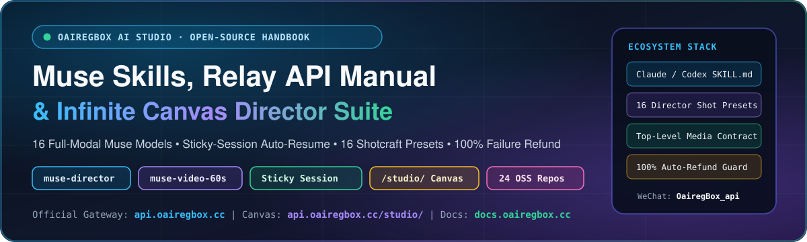
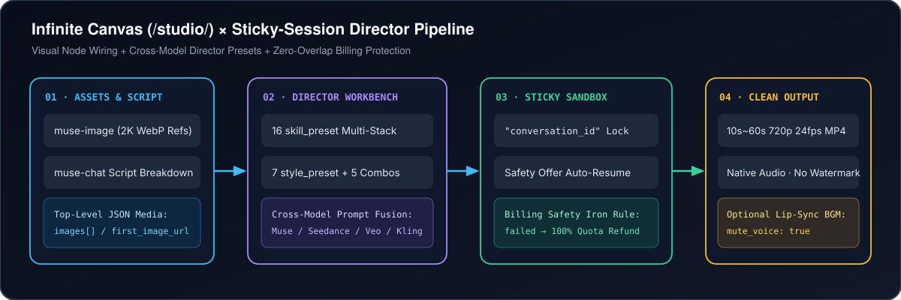

<p align="center">
  <a href="https://api.oairegbox.cc">
    
  </a>
</p>

<h1 align="center">Muse Skills, Relay API Manual &amp; Infinite Canvas Handbook</h1>

<p align="center">
  <a href="https://api.oairegbox.cc"></a>
  <a href="https://api.oairegbox.cc/studio/"></a>
  <a href="https://docs.oairegbox.cc/#sec-muse"></a>
  <a href="https://mirror.oairegbox.cc"></a>
</p>

<p align="center">
  <a href="./LICENSE"></a>
  <a href="./docs/01-MUSE_RELAY_API_MANUAL.md"></a>
  <a href="./docs/04-DIRECTOR_SKILLS_AND_24_REPOS.md"></a>
  <a href="./presets/director_presets_catalog.json"></a>
  
</p>

面向 AI 短剧/漫剧创作者、无限画布（Infinite Canvas `/studio/`）用户与 Agent 开发者的 **Meta Muse（`muse-fast`）全模态中转使用规范、粘性会话接续指南、无限画布多模态工作流手册与 AI 导演预设 Skills 开源套件**。由 **[OairegBox 全模态 AI 网关与创作工作台](https://api.oairegbox.cc)** 官方整理维护。

> **开源边界说明**：本仓库开源 **客户端调用规范、Claude Code / Codex / OpenClaw 标准 `SKILL.md` 技能包、16 套电影学与开源导演蒸馏预设（`director_presets_catalog.json`）、无限画布连线手册与多语言示例脚本**，供社区与企业业务直接集成复用；服务端底层网关实现不在本仓库开源范围内。

---

## 🌐 OairegBox 官方生态与一站式接入入口

无需自建复杂的跨国云端沙盒，直接通过 **OairegBox** 标准 OpenAI 兼容网关即可一站式调用 **Meta Muse 全系 16 款模型** 以及 **Seedance 2.0/2.5、Google Veo 3.1 / Omni 1.1、Kling 3.0、通义万相 Wan 3.0、GPT-Image 2.5、Grok Imagine、Claude / Gemini / DeepSeek** 等百余款全球旗舰模型：

| 入口名称 | 官方直达地址 | 核心能力说明 |
| :--- | :--- | :--- |
| **🚀 API 控制台（主线路 · 欧洲）** | **[https://api.oairegbox.cc](https://api.oairegbox.cc)** | 注册即领统一 `sk-...` 令牌，自助充值、任务日志追踪、额度明细实时可查 |
| **🌎 API 备用入口（美东加速）** | **[https://newapi.oairegbox.cc](https://newapi.oairegbox.cc)** | 与主线路**同账号、同令牌、同余额互通**，按客户端所在区域就近择优接入 |
| **🎨 无限画布工作台（Studio）** | **[https://api.oairegbox.cc/studio/](https://api.oairegbox.cc/studio/)** | 可视化节点连线编排（剧本 → 2K人设图 → 16套导演运镜预设 → 60s长视频续写） |
| **📖 交互式文档与 ¥0 模拟调试台** | **[https://docs.oairegbox.cc/#sec-muse](https://docs.oairegbox.cc/#sec-muse)** | 支持 **¥0 免费模拟测试 / 真实调用** 双模式，内置 cURL/Python/Go/Node.js/Java/PHP 6 语言实时代码生成 |
| **✨ 官方原生镜像工作站** | **[https://mirror.oairegbox.cc](https://mirror.oairegbox.cc)** | 开箱即用的 Web 多模态对话与创作镜像站 |
| **💬 企业定制 / 大额折扣 / 排障客服** | 管理员微信：**`OairegBox_api`** | 技术对接答疑、漫剧团队高并发配额开通、企业大额专属折扣与交流群 |

---

## 🎬 全链路架构：无限画布 × 导演预设 × 粘性沙盒安全接续

<p align="center">
  
</p>

---

## 📂 仓库结构导航

```text
muse-skills-handbook/
├── assets/                                      # 架构图解与视觉横幅
│   ├── hero-banner.svg
│   └── canvas-workflow.svg
├── skills/                                      # 标准 AI Agent 技能包（直接放入 .claude/skills/ 或 .agents/skills/）
│   ├── muse-relay-api/SKILL.md                  # 技能1：Muse 16款模型中转调用、顶层媒体契约、粘性会话接续与退费铁律
│   ├── muse-director-shotcraft/SKILL.md         # 技能2：漫剧/短剧导演五大法则、16套运镜转场预设、7套画风与5套黄金组合
│   └── muse-infinite-canvas/SKILL.md            # 技能3：无限画布（/studio/）多模态节点连线、视频续写防呆与跨模型导演赋能
├── docs/                                        # 完整中文实战手册
│   ├── 01-MUSE_RELAY_API_MANUAL.md              # 《Muse 全模态中转 API 完整操作手册》（16款模型价格、参数与防坑规则）
│   ├── 02-STICKY_SESSION_AND_BILLING_GUIDE.md   # 《遭遇安全建议时的“粘性会话接续”与 100% 计费保障指南》
│   ├── 03-INFINITE_CANVAS_WORKFLOW_GUIDE.md     # 《无限画布（Infinite Canvas）多模态连线与 AI 导演工作台实战手册》
│   └── 04-DIRECTOR_SKILLS_AND_24_REPOS.md       # 《16 套导演转场预设 + 7 套视觉画风 + 全球 24 大开源导演 Skills 图鉴》
├── presets/
│   └── director_presets_catalog.json            # 结构化 JSON（7画风 + 16导演技能 + 5黄金组合 + 24大开源仓库完整元数据）
└── examples/                                    # 零硬编码密钥的可运行调用示例
    ├── sticky_session_director_resume.py        # Python：粘性会话绑定 + 安全替代方案自动/手动接续出片演示
    ├── multi_ref_and_director_presets.py        # Python：JSON 顶层多参考图 + 导演预设叠加 + 非 Muse 模型跨模型注入器
    └── curl_quickstart.sh                       # Bash/cURL：模型发现、云端沙盒对话、原生2K生图、长视频提交速查
```

---

## 🚀 快速安装 Agent Skills（Claude Code / Codex / Cursor）

将 `skills/` 目录下的技能复制到您的项目或全局技能目录，即可让编码与创作 Agent 自动掌握正确的顶层参数格式、导演运镜组合与粘性会话恢复逻辑：

```bash
# 克隆仓库
git clone https://github.com/abigail-cook-960/muse-skills-handbook.git
cd muse-skills-handbook

# 安装到当前项目的 Claude Code 技能目录
mkdir -p .claude/skills
cp -R skills/* .claude/skills/

# 或安装到全局 ~/.claude/skills/
mkdir -p ~/.claude/skills
cp -R skills/* ~/.claude/skills/
```

配置 `.env` 环境变量（前往 **[https://api.oairegbox.cc](https://api.oairegbox.cc)** 获取 `sk-...` 密钥，参考 `.env.example`）：

```bash
cp .env.example .env
# 编辑 .env 填入 OAIREGBOX_API_BASE_URL=https://api.oairegbox.cc 与您的 OAIREGBOX_API_KEY
```

---

## ⭐ 核心能力与防坑铁律速览

### 1. 16 款 Muse 全模态模型一站式打通（默认有声 · 无水印直出）
- **对话与自主云端沙盒**：`muse-chat`、`muse-agent`（别名 `muse-spark`）
- **原生 2K 无水印图像与多图编辑**：`muse-image`（`¥0.03/张` 特惠直出，`≤4` 张参考图，原生高画质 WebP）
- **原生 720p 24fps 有声视频全档位**：`muse-video`（`1~10s`）、`muse-video-20s / 30s / 40s / 50s / 60s`（多段无缝拼接 & `video_url` 续写，支持 `mute_voice: true` 保留口型表演剥离说话人声、保留 BGM/环境音）
- **AI 漫剧 / 短剧自主导演**：`muse-director`（剧本文件 + 最多 6 张人设/分镜图自动编排，按 `过程生图张数 + 实际成片秒数` 透明结算）
- **播客与全双工语音矩阵**：`muse-podcast`（多音色对谈 MP3）、`muse-tts`（Avocado v2）、`muse-asr`、`muse-audio`、`muse-live`

### 2. 遭遇安全替代建议时的「粘性会话无缝接续」与 100% 退费保障
当高冲突戏剧提示词触发温和安全替代建议（如 `"A different direction I can make for you... Let me know if you'd like me to build the 60 seconds that way."`）且超时退出时：
- **失败 100% 自动全额退费**：终态 `failed` 任务由网关自动全额退回预扣额度（`type=6`），仅成功产出可读视频的 `completed` 任务实扣，**零重叠扣费**；
- **同沙盒免重做设定图接续**：从第 1 轮起在 `/v1/videos` 的 **JSON Body 顶层**传入自定义 `"conversation_id"`，第 2 轮复用同一 `"conversation_id"` 回复确认，即可直接复用云端沙盒内已生成的角色设定图与导演分镜符极速出片。详见 [`docs/02-STICKY_SESSION_AND_BILLING_GUIDE.md`](./docs/02-STICKY_SESSION_AND_BILLING_GUIDE.md)。

### 3. 无限画布（`/studio/`）× 16 套导演预设 × 24 大开源导演生态库
- 在 **[无限画布 `/studio/`](https://api.oairegbox.cc/studio/)** 视频节点点击 **🎬 场记板按钮** 即可一键组合 **5 套黄金导演配方**、**16 套 `skill_preset`**（前景遮挡无缝转场 `occlusion_wipe`、黄金3秒冲突钩子 `micro_drama_hook`、潜台词微表情 `emotion_micro_acting`、仙侠变速运镜 `xianxia_speed_ramp`、三维空间走位连戏锁 `spatial_blocking_continuity` 等）与 **7 套 `style_preset`**；
- **跨模型共享赋能**：对 `muse-*` 原生直传顶层预设字段；对画布内 `seedance-2.0/2.5`、`flow-omni`、`flow-veo`、`kling-v3`、`wan3.0-video`、`grok-imagine-video` 自动将专业镜头语言融合注入 `prompt`。详见 [`docs/03-INFINITE_CANVAS_WORKFLOW_GUIDE.md`](./docs/03-INFINITE_CANVAS_WORKFLOW_GUIDE.md) 与 [`docs/04-DIRECTOR_SKILLS_AND_24_REPOS.md`](./docs/04-DIRECTOR_SKILLS_AND_24_REPOS.md)。

---

## 📜 开源协议与社区致敬

本项目采用 [MIT License](./LICENSE) 开源。向 `OpenMontage`、`Toonflow-app`、`huobao-drama`、`video-shotcraft`、`waoowaoo`、`ViMax`、`lemo-opuscar`、`Jellyfish`、`shuohao-skills`、`seedance2-skill`、`drama-skills`、`FireRed-OpenStoryline`、`manju-laoli-skill`、`awesome-short-drama-skills`、`lumenx`、`zy-cinematic-realism`、`shanyin-director-master`、`ai-shortfilm-prompts`、`seedance-tvc-director`、`DirectorSKILL`、`xianxia-cinematic-video-director`、`director-skills`、`cinematic-video-prompt-skill`、`muse-video-skill` 等 24 个优秀开源 AI 影视导演社区项目致敬。
